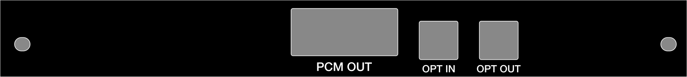

# X68000_slotcover

Expansion slot cover (rear faceplate / bracket) for Sharp X68000 computers, as vector drawings you can
laser-cut, mill, or print 1:1 as a paper template.

Two versions:

| Folder | What | Files |
|---|---|---|
| `template/` | Blank cover: plate outline and the two screw slots, no cutouts | `blank.dxf`, `blank.svg`, `blank.pdf` |
| `mercury/` | Cover for the **Mercury Unit** sound board (OPT OUT, OPT IN, PCM OUT cutouts and labels) | `faceplate.dxf`, `faceplate.svg`, `faceplate.pdf`, notes |

All dimensions are mm. SVG/PDF are 1:1 with the origin at the top-left (front view, labels facing you).
DXF is R12, `$INSUNITS` = mm, origin at the bottom-left (Y up), layers `OUTLINE` / `CUTOUTS` / `HOLES` / `TEXT`.

## Plate (both versions)

- 20 wide × 177 tall, measured on a real X68000 cover (176.5 measured; bottom edge given 0.5 extra).
- Two screw slots on X = 11.5 from the left edge: top slot center 4.5 from the top edge, bottom slot
  center 171 from the top edge (6 from the bottom). Each slot is Ø3.5 with 0.5 of slack along the plate
  (3.5 × 4.0 overall), so the 166.5 hole pitch tolerates ±0.25.
- Countersinks were not measured; slots are drawn plain.

## Mercury Unit version



Cutout positions were measured on the unit (±0.5); cutout sizes were taken from a dewarped photo of an
original cover (±0.5) and should be checked against the real connectors before cutting. Labels are
Helvetica Neue Medium converted to outlines, reading bottom to top beside each cutout. The CTRL and
OPN3-L cutouts seen on some original covers are omitted.

Full dimension table, label metrics, and the before-you-cut checklist: [`mercury/faceplate_dimensions.md`](mercury/faceplate_dimensions.md).

## Before cutting

1. Print the SVG or PDF at 100% (no fit-to-page). Check the plate is 177 tall and the slots 166.5 apart.
2. Hold the paper against the card. If a connector is tight, add ~0.3 clearance per side to that cutout.
3. On the Mercury cover the 2.2 strip beside PCM OUT bends easily; cut it last or support it.

## Font

Labels on the Mercury cover are set in Helvetica Neue Medium (OPT OUT / OPT IN at 2.6 mm, PCM OUT at
3.1 mm) and converted to outlines, so no font is needed to use the files. Plain Helvetica Medium or
Bold is a close match if you re-set them.

## Files

```
template/blank.{dxf,svg,pdf}     blank cover
mercury/faceplate.{dxf,svg,pdf}  Mercury Unit cover
mercury/faceplate.png            render of the above, rotated 90° (top of plate on the right)
mercury/faceplate_dimensions.md  notes: dimensions, provenance, checklist
```
